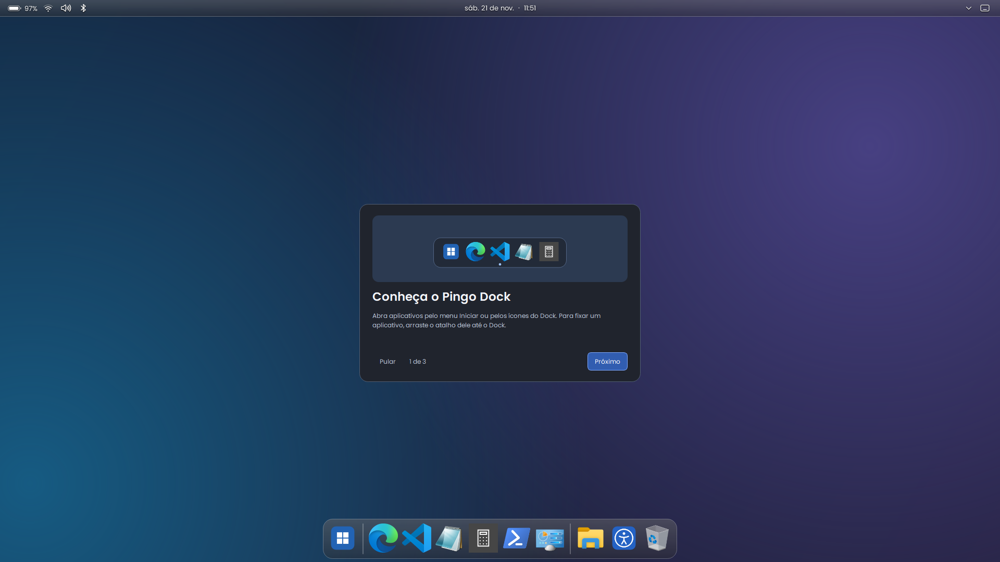
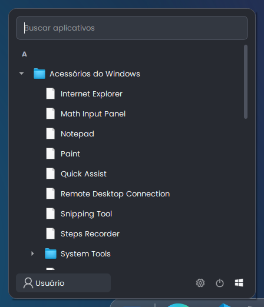
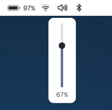
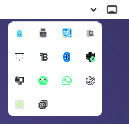

<p align="center">
  
</p>

<h1 align="center">Pingo Dock</h1>

<p align="center">
  Um Dock na base e uma barra de tarefas minimalista no topo do Windows.
</p>

<p align="center">
  <a href="../../releases/latest"><b>Baixar o instalador</b></a> ·
  <a href="#instalação">Instalação</a> ·
  <a href="#como-usar">Como usar</a> ·
  <a href="#desenvolvimento">Desenvolvimento</a>
</p>



O **Pingo Dock 1.4** substitui visualmente a barra de tarefas do Windows enquanto está em execução. O Dock reúne os aplicativos fixados e abertos na base da tela. A barra superior concentra a data, a hora e os controles do sistema.

## O que mudou na versão 1.4

### Aplicativos e janelas no Dock

Aplicativos abertos aparecem automaticamente. Se o app estiver fixado, as janelas ficam agrupadas no próprio ícone. Passe o mouse sobre o ícone para ver as miniaturas e sobre uma miniatura para ampliá-la. **Só o clique traz a janela para frente.**

O **Iniciar** fica no começo do Dock. No fim, ficam **Explorador de Arquivos**, **Acessibilidade** e **Lixeira**. Esses ícones e os separadores que delimitam os grupos são fixos. O menu de Acessibilidade oferece Narrador, Lupa, Teclado Virtual e acesso às configurações do Windows.

Quando um instalador informa o progresso, o Dock mostra uma barra abaixo do ícone e a porcentagem ao passar o mouse.


### Menu Iniciar

Abra pelo primeiro ícone do Dock ou pressione a **tecla Windows sozinha**. Os aplicativos aparecem em ordem alfabética, com seus ícones e pastas expansíveis. A busca também encontra itens dentro das pastas.

No rodapé aparecem a conta do usuário e os atalhos para **Configurações**, **Energia** e **Menu do Windows**. Atalhos como **Win+D** e **Win+E** continuam funcionando.

<p align="center">
  
</p>

### Barra superior

- **À esquerda**, bateria com porcentagem, Wi‑Fi, volume e Bluetooth. Clique no Wi‑Fi para ver as conexões disponíveis, no volume para ajustar o som por um controle vertical e no Bluetooth para abrir suas configurações.
- **No centro**, dia da semana, data e hora.
- **À direita**, a seta abre a bandeja de ícones promovidos e ocultos, incluindo aplicativos em segundo plano como o Wallpaper Engine quando registrado pelo Windows. O botão ao lado mostra a área de trabalho e um segundo clique restaura as janelas.

A barra tem quatro estilos, **Transparente**, **Preto**, **Branco** e **Vidro fosco**. O controle de volume e a bandeja acompanham o estilo escolhido. O clique direito na barra superior abre o menu de contexto nativo do Windows.

<p align="center">
  
  
</p>

## Instalação

1. Baixe o arquivo `PingoDock-Setup-<versão>.exe` em [Releases](../../releases/latest).
2. Execute o instalador e siga o assistente. A instalação é por usuário e oferece a opção de iniciar o Pingo Dock junto com o Windows.
3. Abra o Pingo Dock. Na primeira execução, o guia de boas-vindas explica como fixar aplicativos, trocar de janela e usar a barra superior.

O instalador é para Windows de 64 bits. Os recursos da 1.4 foram verificados no Windows 10. A integração com os painéis nativos, como a área de notificação, depende da versão do Windows.

Para voltar à barra de tarefas do Windows, clique com o botão direito no Dock e escolha **Sair do Dock**. Para desinstalar, abra **Configurações → Aplicativos → Pingo Dock**.

> Se você já usava o **MacDock**, pode instalar o Pingo Dock por cima. O instalador migra as preferências e remove a instalação antiga.

<details>
<summary>Instalação silenciosa</summary>

```powershell
PingoDock-Setup-1.4.2.exe /VERYSILENT /MERGETASKS="startup"
```

Use `/MERGETASKS="!startup"` para desativar a inicialização com o Windows.

</details>

## Como usar

| Ação | Como fazer |
|---|---|
| Fixar um aplicativo, pasta ou arquivo | Arraste do Explorador para o Dock ou use **Adicionar aplicativo…** no menu do Dock. |
| Abrir um arquivo em um aplicativo | Solte o arquivo em cima do ícone do app correspondente. |
| Reordenar itens ou adicionar um separador | Arraste os itens para os lados ou use **Adicionar separador** no menu do Dock. |
| Remover um item fixado por você | Arraste-o para cima e solte ou use **Remover do Dock**. |
| Fechar uma janela ou listar as janelas de um app | Clique com o botão direito no ícone do aplicativo. |
| Usar a Lixeira | Arraste o arquivo até ela. Clique com o botão direito para esvaziá-la. |
| Mostrar ou ocultar o Dock | Pressione **Ctrl+Alt+D**. |
| Ativar o Dock em outros monitores | No menu do Dock, escolha **Mostrar em todas as telas**. |
| Ajustar o visual | No menu do Dock, use **Aparência**, **Tamanho dos ícones** ou **Aparência da barra superior**. |
| Rever o guia | Clique com o botão direito no Dock → **Como usar o Pingo Dock**. |

<p align="center">
  
</p>

O Dock amplia os ícones ao passar o mouse. Com uma janela maximizada, ele pode se recolher e reaparecer quando o cursor chega à borda inferior. O menu do Dock também permite ajustar a ampliação, o desfoque e a ocultação automática.

## Configuração e suporte

O Pingo Dock guarda as preferências em `%APPDATA%\PingoDock\config.json`. O arquivo contém o atalho (`hotkey`), os itens fixados (`apps`) e o estilo da barra superior (`top_bar_style`).

Ao relatar um problema em [Issues](../../issues), informe a versão do Pingo Dock e do Windows, descreva os passos para reproduzir e, se for relevante, anexe o `dock.log` dessa mesma pasta após revisar seu conteúdo.

## Desenvolvimento

O projeto usa **Python**, **PySide6** e APIs do Windows. A fonte padrão é **Poppins**, distribuída com o instalador e sua licença OFL.

| Ação | Comando ou arquivo |
|---|---|
| Criar o ambiente e iniciar o Dock a partir do código | `iniciar_dock.bat` |
| Rodar a prévia do desktop com recarga automática | `.venv\Scripts\python.exe dev.py` |
| Gerar o instalador com PyInstaller e Inno Setup 6 | `.venv\Scripts\python.exe installer\build.py` |
| Executar o autoteste do pacote | `build\dist\PingoDock\PingoDock.exe --selftest` |
| Capturar as telas do README | `.venv\Scripts\python.exe docs\gerar_prints.py` |

Os prints foram capturados com o aplicativo em execução, usando um perfil temporário com dados de demonstração.

## Licença

O Pingo Dock é gratuito para **uso não comercial**, sob a [PolyForm Noncommercial License 1.0.0](LICENSE). Cópias e versões modificadas devem preservar a licença e o aviso de autoria **Copyright (c) 2026 Gabriel Nicolas**. Para uso comercial, entre em contato com o autor.

As licenças de Poppins, Qt/PySide6 e Python estão listadas em [THIRD_PARTY_NOTICES.md](THIRD_PARTY_NOTICES.md).

---

<p align="center">
  Feito por <a href="https://github.com/Nik0lax">Gabriel Nicolas</a> · parte da família <b>Pingo</b>
</p>
