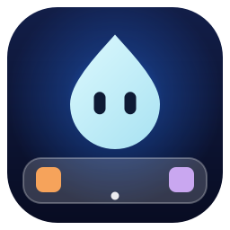
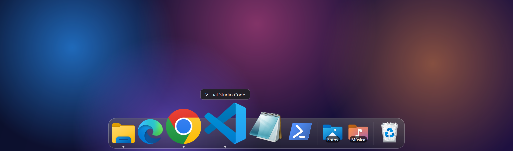
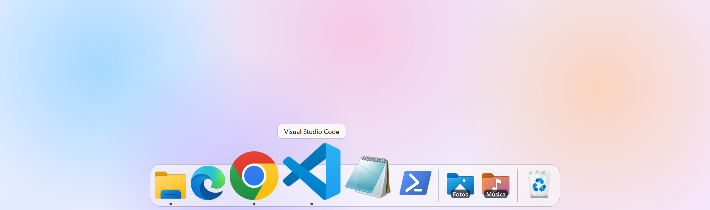

<p align="center">
  
</p>

<h1 align="center">Pingo Dock</h1>

<p align="center">
  <b>Um dock elegante para Windows — da família Pingo.</b><br>
  Seus apps, pastas e links numa barra de vidro, com ícones que crescem quando o mouse passa.
</p>

<p align="center">
  <a href="../../releases/latest"><b>⬇ Baixar o instalador</b></a> ·
  <a href="#recursos">Recursos</a> ·
  <a href="#como-usar">Como usar</a> ·
  <a href="#licença">Licença</a>
</p>



---

## Por que "Pingo"?

Pingo é uma gota — e uma gota d'água funciona como lente: amplia o que está embaixo dela.
É exatamente o que o dock faz com os ícones. O nome também vem do **Pingo**, o assistente virtual
do mesmo autor, que empresta o rosto para o ícone do app.

## Recursos

- **Ampliação dos ícones** ao passar o mouse, com o nome do app e um "pulinho" ao abrir.
- **Bolinha nos apps abertos** — clicar num app já aberto traz a janela dele para frente.
- **Clique direito num app** lista as janelas abertas (para ir direto na certa) e tem **Fechar**.
- **Solte um arquivo em cima de um app** para abri-lo com ele; solte entre os ícones para fixá-lo.
- **Lixeira** no fim do dock: arraste arquivos para ela; clique direito para esvaziar.
- **Pastas com nome**, separadores e reordenação arrastando os ícones.
- **Fundo desfocado** e **tema claro/escuro automático**, igual ao do Windows.
- **Ctrl+Alt+D** mostra ou esconde o dock.
- **Sai do caminho sozinho**: desce quando uma janela é maximizada (volta ao encostar o mouse na
  borda de baixo) e some em vídeos, jogos e apresentações em tela cheia — mas continua aparecendo
  nos seus prints de tela.
- **Leve**: cerca de 30 MB de memória, um processo só, instalação sem administrador.
- **Atualização com um clique** quando há versão nova publicada (opcional).



## Instalação

1. Baixe o `PingoDock-Setup-<versão>.exe` na [página de releases](../../releases/latest).
2. Execute e siga o assistente. Ele instala só para o seu usuário (sem administrador), cria o atalho
   no Menu Iniciar e oferece iniciar o dock junto com o Windows.

Requisitos: Windows 10 ou 11, 64 bits. Para desinstalar: *Configurações → Aplicativos → Pingo Dock*.

> **Já usava o MacDock?** É o nome antigo do Pingo Dock. Instale por cima: seus apps, a ordem e as
> opções são mantidos, e o MacDock é removido.

<details>
<summary>Instalação silenciosa (para vários PCs)</summary>

```
PingoDock-Setup-1.2.0.exe /VERYSILENT /MERGETASKS="startup"
```

Use `/MERGETASKS="!startup"` para não iniciar com o Windows.
</details>

## Como usar

| Para… | Faça |
|---|---|
| Abrir um app ou trazer a janela para frente | Clique no ícone |
| Fixar um app, pasta ou arquivo | Arraste do Explorador para o dock, ou clique direito → *Adicionar aplicativo…* |
| Abrir um arquivo com um app do dock | Arraste o arquivo e solte **em cima** do ícone do app |
| Ver as janelas de um app ou fechá-lo | Clique direito no ícone |
| Mandar arquivos para a Lixeira | Solte-os em cima da Lixeira |
| Reordenar | Arraste o ícone para os lados |
| Remover | Arraste o ícone para cima e solte, ou clique direito → *Remover do Dock* |
| Separar grupos de ícones | Clique direito → *Adicionar separador* |
| Encurtar o nome de uma pasta | Clique direito → *Renomear…* |
| Mostrar / esconder o dock | **Ctrl+Alt+D** |
| Mudar tema, desfoque, tamanho, ampliação | Clique direito no dock |

**Dica:** para o visual ficar completo, ative *Ocultar automaticamente a barra de tarefas* em
*Configurações → Personalização → Barra de tarefas*.

## Configuração

As opções ficam em `%APPDATA%\PingoDock\config.json`. Quase tudo se ajusta pelo clique direito;
algumas opções só existem no arquivo:

| Chave | Para quê |
|---|---|
| `"hotkey"` | Atalho de mostrar/esconder — ex.: `"Ctrl+Alt+D"`, `"Win+Shift+D"`, `"Ctrl+Alt+F9"` |
| `"update_source"` | Pasta de rede ou endereço `http://` onde procurar versões novas |
| `"apps"` | Os itens do dock, na ordem (dá para editar os nomes à mão) |

A bolinha de "aberto" aparece quando o app tem alguma janela, mesmo minimizada. Para atalhos que
abrem outro programa (lançadores, apps da Microsoft Store, Steam), o dock aprende sozinho qual é o
processo real na primeira vez que você abre o app por ele.

Algo estranho? O arquivo `dock.log`, na mesma pasta, registra quando e por que o dock se escondeu e
os erros de atualização — anexe-o ao abrir uma *issue*.

## Desenvolvimento

Feito em **Python 3.12** + **[PySide6](https://doc.qt.io/qtforpython-6/)** (Qt), com chamadas diretas
à API do Windows via `ctypes`. O dock inteiro está em [`dock.py`](dock.py).

| Para… | Comando |
|---|---|
| Rodar a partir do código | Dois cliques em `iniciar_dock.bat` (na 1ª vez cria o `.venv` e instala as dependências) |
| Gerar o instalador (~17 MB) | `.venv\Scripts\python.exe installer\build.py` (requer `pip install pyinstaller` e `winget install JRSoftware.InnoSetup --scope user`) |
| Conferir um build | `build\dist\PingoDock\PingoDock.exe --selftest` (resultado em `selftest.log`) |
| Regerar os prints deste README | `.venv\Scripts\python.exe docs\gerar_prints.py` |

A versão de desenvolvimento e a instalada não rodam ao mesmo tempo: feche uma
(clique direito → *Sair do Dock*) antes de abrir a outra.

## Licença

O Pingo Dock é **gratuito para uso não comercial**, sob a
**[PolyForm Noncommercial License 1.0.0](LICENSE)**.

| Pode ✅ | Não pode sem autorização ❌ |
|---|---|
| Usar no seu computador pessoal, nos estudos, como hobby | Vender o Pingo Dock ou versões dele |
| Usar em ONGs, escolas, universidades, hospitais filantrópicos e órgãos públicos | Usar dentro de empresas com fins lucrativos (mesmo só internamente) |
| Estudar o código, modificar e compartilhar (sem fins comerciais) | Incluir em produtos ou serviços pagos |
| | Distribuir sem o aviso de autoria (`Required Notice` no topo do [LICENSE](LICENSE)) |

Toda cópia ou versão modificada precisa manter o aviso **"Copyright (c) 2026 Gabriel Nicolas"** e a
licença. Quer usar na sua empresa ou num produto? Entre em contato com o autor para uma licença
comercial.

> Por proibir o uso comercial, o Pingo Dock tem **código aberto para consulta e uso não comercial**,
> mas não é "open source" na definição da OSI.

O instalador também inclui o Qt/PySide6 (LGPL-3.0) e o Python (PSF), cada um com a sua própria
licença — veja [THIRD_PARTY_NOTICES.md](THIRD_PARTY_NOTICES.md).

---

<p align="center">
  Feito por <a href="https://github.com/Nik0lax">Gabriel Nicolas</a> · parte da família <b>Pingo</b> 💧
</p>
