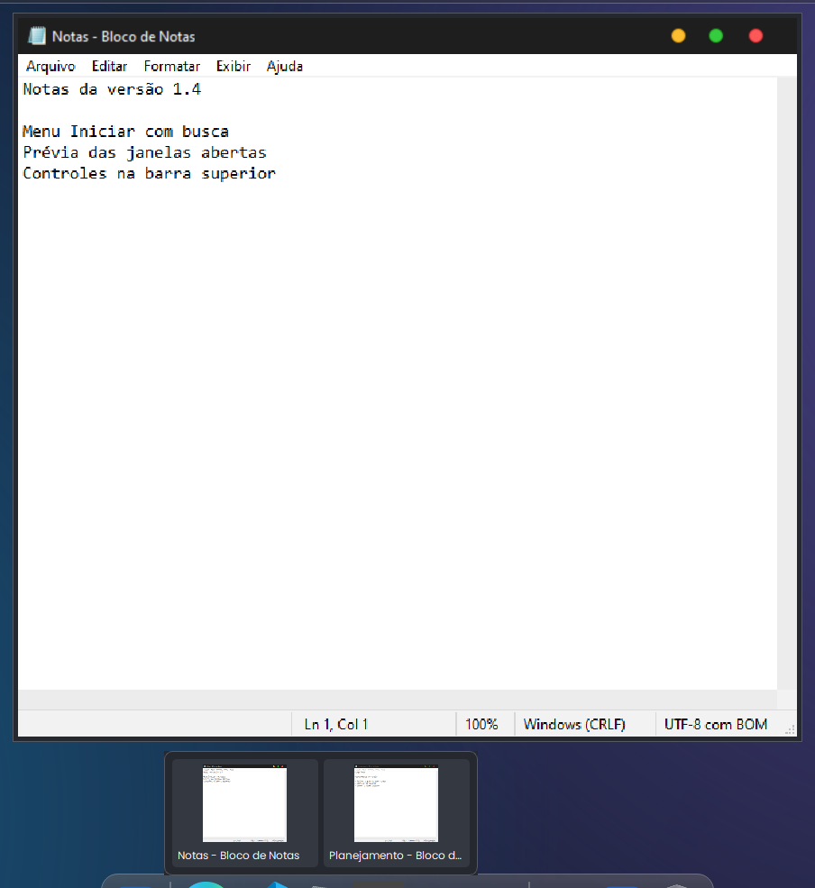
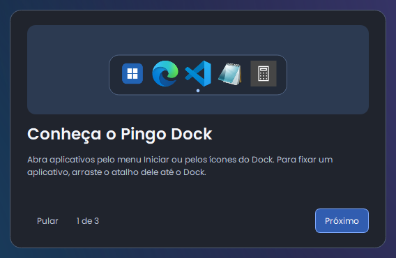

<p align="center">
  
</p>

<h1 align="center">Pingo Dock</h1>

<p align="center">
  Um Dock na base e uma barra de tarefas minimalista no topo do Windows.
</p>

<p align="center">
  <a href="../../releases/latest"><b>Baixar o instalador</b></a> ·
  <a href="#consumo-de-ram">Consumo de RAM</a> ·
  <a href="#instalação">Instalação</a> ·
  <a href="#como-usar">Como usar</a> ·
  <a href="#desenvolvimento">Desenvolvimento</a>
</p>


O **Pingo Dock 1.4** substitui visualmente a barra de tarefas do Windows enquanto está em execução. O Dock reúne os aplicativos fixados e abertos na base da tela. A barra superior concentra a data, a hora e os controles do sistema.

## Novidades da versão 1.4.6

- **Bandeja própria com os menus originais dos apps.** O Pingo recebe os registros de ícones, separa **Sistema** e **Aplicativos** e encaminha o clique ao aplicativo dono do ícone. A lista se atualiza enquanto o painel está aberto e tenta se recuperar após reinício do Explorer ou retorno da suspensão.
- **Navegação por teclado.** Use **Ctrl+Alt+K**, percorra os ícones com **←/→** e abra o menu do ícone com **Shift+F10**.
- **Preferências por monitor.** Escolha onde o Dock aparece e em qual tela fica a barra superior. As preferências voltam quando a tela escolhida é reconectada.
- **Bordas do Dock.** O desfoque acompanha o contorno arredondado nos temas claro, escuro e automático.

## Novidades da versão 1.4.3

- **Menos RAM no auxiliar da barra.** A restauração da barra nativa agora usa um executável Win32 sem carregar Python. Veja a [medição de RAM](#consumo-de-ram).
- **Janelas organizadas pelo Dock.** Clique com o botão direito na miniatura para encaixar à esquerda ou à direita, ou mover a janela para outro monitor conectado. A miniatura indica o monitor e destaca a janela ativa.
- **Menu de clique direito mais curto.** Volte à janela, abra outra ou fixe um app aberto diretamente. Opções do atalho, configurações e ajuda ficam em submenus.
- **Ícones mais nítidos.** O Dock usa imagens em alta resolução dos próprios apps da Microsoft Store e dá preferência às versões com fundo transparente.
- **Iniciar com busca e teclado.** A busca prioriza nomes exatos e prefixos, ignora acentos e mantém o foco no campo enquanto você navega com **↑/↓**.

## Consumo de RAM

**A compilação 1.4.5 com a nova bandeja usou 8,03 MiB de RAM privada residente em repouso neste teste.** A comparação abaixo inclui o Dock e o auxiliar de restauração da barra.

| Cenário | RAM residente 1.4.3 | RAM residente 1.4.5 | Memória comprometida 1.4.3 | Memória comprometida 1.4.5 |
|---|---:|---:|---:|---:|
| Repouso | 9,67 MiB | **8,03 MiB** | 34,36 MiB | 34,40 MiB |
| Bandeja aberta | 12,79 MiB | **11,04 MiB** | 34,56 MiB | 34,51 MiB |
| Iniciar aberto | 23,24 MiB | **22,93 MiB** | 41,71 MiB | 41,54 MiB |
| Miniaturas abertas | 23,85 MiB | 24,02 MiB | 42,17 MiB | 42,22 MiB |

Medições no Windows 10 Home, build 19045, com Explorer ativo e o mesmo perfil do Dock. Em cada pacote, esperei 15 segundos após iniciar e medi os quatro cenários em sequência. Os valores são medianas de seis amostras por cenário. A memória do Explorer fica fora da tabela, inclusive a usada pela bandeja nativa na 1.4.3.

### Comparação anterior com a 1.4.2

**A versão 1.4.3 usou 9,84 MiB de RAM física privada em repouso, ante 28,57 MiB na 1.4.2.** A redução foi de **18,73 MiB (65,6%)** neste teste.

| Métrica | 1.4.2 | 1.4.3 |
|---|---:|---:|
| RAM física privada do Dock e do auxiliar | 28,57 MiB | **9,84 MiB** |
| Memória privada comprometida do Dock e do auxiliar | 61,32 MiB | **34,59 MiB** |
| RAM física privada só do auxiliar de restauração | 21,19 MiB | **0,53 MiB** |

Os números são medianas de 10 amostras coletadas a intervalos de aproximadamente um segundo, após 15 segundos de inicialização. Usei os executáveis extraídos dos dois instaladores, no mesmo Windows 10 Home (build 19045), com o mesmo perfil do Dock e o Explorer ativo. O resultado mede os processos do Pingo Dock. A economia varia com a máquina e o uso.

## O que mudou na versão 1.4

### Aplicativos e janelas no Dock

Aplicativos abertos aparecem automaticamente. Se o app estiver fixado, as janelas ficam agrupadas no próprio ícone. Passe o mouse sobre o ícone para ver as miniaturas e sobre uma miniatura para ampliá-la. **Só o clique traz a janela para frente.**

O **Iniciar** fica no começo do Dock. No fim, ficam **Explorador de Arquivos**, **Acessibilidade** e **Lixeira**. Esses ícones e os separadores que delimitam os grupos são fixos. O menu de Acessibilidade oferece Narrador, Lupa, Teclado Virtual e acesso às configurações do Windows.

Quando um instalador informa o progresso, o Dock mostra uma barra abaixo do ícone e a porcentagem ao passar o mouse.



### Menu Iniciar

Abra pelo primeiro ícone do Dock ou pressione a **tecla Windows sozinha**. Os aplicativos aparecem em ordem alfabética, com seus ícones e pastas expansíveis. A busca também encontra itens dentro das pastas.

No rodapé aparecem a conta do usuário e os atalhos para **Configurações**, **Energia** e **Menu do Windows**. Atalhos como **Win+D** e **Win+E** continuam funcionando.

<p align="center">
  
</p>

### Barra superior

- **À esquerda**, bateria com porcentagem, Wi‑Fi, volume e Bluetooth. Clique no Wi‑Fi para ver as conexões disponíveis, no volume para ajustar o som por um controle vertical e no Bluetooth para abrir suas configurações.
- **No centro**, dia da semana, data e hora.
- **À direita**, a seta abre o painel de aplicativos em segundo plano do Pingo Dock. O botão ao lado mostra a área de trabalho e um segundo clique restaura as janelas.

A barra tem quatro estilos, **Transparente**, **Preto**, **Branco** e **Vidro fosco**. O controle de volume e a bandeja acompanham o estilo escolhido. O clique direito na barra superior abre o menu de contexto nativo do Windows.

<p align="center">
  
</p>

## Instalação

1. Baixe o arquivo `PingoDock-Setup-<versão>.exe` em [Releases](../../releases/latest).
2. Execute o instalador e siga o assistente. A instalação é por usuário e oferece a opção de iniciar o Pingo Dock junto com o Windows.
3. Abra o Pingo Dock. Na primeira execução, o guia de boas-vindas explica como fixar aplicativos, trocar de janela e usar a barra superior.

O instalador é para Windows de 64 bits. Os recursos da 1.4 foram verificados no Windows 10. A integração com os painéis nativos, como a área de notificação, depende da versão do Windows.

Para voltar à barra de tarefas do Windows, clique com o botão direito no Dock e escolha **Sair do Dock**. Para desinstalar, abra **Configurações → Aplicativos → Pingo Dock**.

> Se você já usava o **MacDock**, pode instalar o Pingo Dock por cima. O instalador migra as preferências e remove a instalação antiga.

<details>
<summary>Instalação silenciosa</summary>

```powershell
PingoDock-Setup-1.4.6.exe /VERYSILENT /MERGETASKS="startup"
```

Use `/MERGETASKS="!startup"` para desativar a inicialização com o Windows.

</details>

## Como usar

| Ação | Como fazer |
|---|---|
| Fixar um aplicativo, pasta ou arquivo | Arraste do Explorador para o Dock ou use **Adicionar aplicativo…** no menu do Dock. |
| Fixar um aplicativo que já está aberto | Clique com o botão direito no ícone temporário e escolha **Fixar no Dock**. |
| Abrir um arquivo em um aplicativo | Solte o arquivo em cima do ícone do app correspondente. |
| Reordenar itens ou adicionar um separador | Arraste os itens para os lados ou use **Adicionar separador** no menu do Dock. |
| Remover um item fixado por você | Arraste-o para cima e solte ou abra **Opções do atalho → Remover do Dock**. |
| Fechar uma janela ou listar as janelas de um app | Clique com o botão direito no ícone do aplicativo. Para fechar uma janela específica, use o **×** na miniatura. |
| Encaixar ou mover uma janela | Clique com o botão direito na miniatura e escolha o lado ou o monitor. |
| Usar a Lixeira | Arraste o arquivo até ela. Clique com o botão direito para esvaziá-la. |
| Mostrar ou ocultar o Dock | Pressione **Ctrl+Alt+D**. |
| Navegar pelo Dock com o teclado | Pressione **Ctrl+Alt+K**, percorra os ícones com **←/→**, abra com **Enter** ou use **Shift+F10** para o menu do ícone. **Esc** encerra a navegação. |
| Escolher os monitores do Dock | Abra **Configurações do Dock → Monitores → Dock** e marque as telas desejadas. |
| Mover a barra superior | Abra **Configurações do Dock → Monitores → Barra superior** e escolha uma tela. Se ela for desconectada, a barra usa a tela principal até a reconexão. |
| Ajustar o visual | Em **Configurações do Dock**, use **Aparência**, **Tamanho dos ícones** ou **Aparência da barra superior**. |
| Rever o guia | Abra **Ajuda e atualizações → Como usar o Pingo Dock** no menu do Dock. |
| Buscar e abrir um app pelo teclado | Pressione **Windows**, digite, escolha com **↑/↓** e abra com **Enter**. **Esc** fecha o menu. |

<p align="center">
  
</p>

O Dock amplia os ícones ao passar o mouse. Com uma janela maximizada, ele pode se recolher e reaparecer quando o cursor chega à borda inferior. O menu do Dock também permite ajustar a ampliação, o desfoque e a ocultação automática.

## Configuração e suporte

O Pingo Dock guarda as preferências em `%APPDATA%\PingoDock\config.json`. O arquivo contém o atalho (`hotkey`), os itens fixados (`apps`) e o estilo da barra superior (`top_bar_style`).

Ao relatar um problema em [Issues](../../issues), informe a versão do Pingo Dock e do Windows, descreva os passos para reproduzir e, se for relevante, anexe o `dock.log` dessa mesma pasta após revisar seu conteúdo.

## Desenvolvimento

O projeto usa **Python**, **PySide6** e APIs do Windows. A fonte padrão é **Poppins**, distribuída com o instalador e sua licença OFL.

| Ação | Comando ou arquivo |
|---|---|
| Criar o ambiente e iniciar o Dock a partir do código | `iniciar_dock.bat` |
| Rodar a prévia do desktop com recarga automática | `.venv\Scripts\python.exe dev.py` |
| Gerar o instalador com PyInstaller, Inno Setup 6 e Zig no PATH | `.venv\Scripts\python.exe installer\build.py` |
| Executar o autoteste do pacote | `build\dist\PingoDock\PingoDock.exe --selftest` |
| Capturar as telas do README | `.venv\Scripts\python.exe docs\gerar_prints.py` |

Os prints foram capturados com o aplicativo em execução, usando um perfil temporário com dados de demonstração.

### Protótipo de shell e teste de memória

`\.venv\Scripts\python.exe dock.py --shell-prototype` inicia o protótipo em uma sessão de laboratório sem o shell do Explorer. Ele usa um perfil próprio em `%LOCALAPPDATA%\PingoDockShellLab`. A opção adicional `--preview` permite conferir a interface no desktop atual e não substitui o shell.

O teste de substituição deve ser feito em uma sessão isolada e numa edição compatível, com o Explorer como shell para o primeiro cenário e o Pingo para os seguintes. A integração de notificações do Windows sem o Explorer e a reserva de espaço para janelas maximizadas ainda precisam de validação nesse modo. [Edições compatíveis com o Shell Launcher](https://learn.microsoft.com/en-us/windows/configuration/shell-launcher/)

Execute `.\docs\medir-shell.ps1 -Cenario Windows`, depois `-Cenario PingoComExplorer` e `-Cenario PingoShell` nos estados correspondentes. Se o Explorador de Arquivos puder ser aberto sem assumir o shell, repita com `-Cenario PingoShellComArquivos`. O medidor valida a sessão e retorna a mediana da RAM disponível, memória comprometida e memória residente privada dos processos. Mantenha os mesmos aplicativos, papel de parede e tempo de espera em cada rodada.

## Licença

O Pingo Dock é gratuito para **uso não comercial**, sob a [PolyForm Noncommercial License 1.0.0](LICENSE). Cópias e versões modificadas devem preservar a licença e o aviso de autoria **Copyright (c) 2026 Gabriel Nicolas**. Para uso comercial, entre em contato com o autor.

As licenças de Poppins, Qt/PySide6 e Python estão listadas em [THIRD_PARTY_NOTICES.md](THIRD_PARTY_NOTICES.md).

---

<p align="center">
  Feito por <a href="https://github.com/Nik0lax">Gabriel Nicolas</a> · parte da família <b>Pingo</b>
</p>
